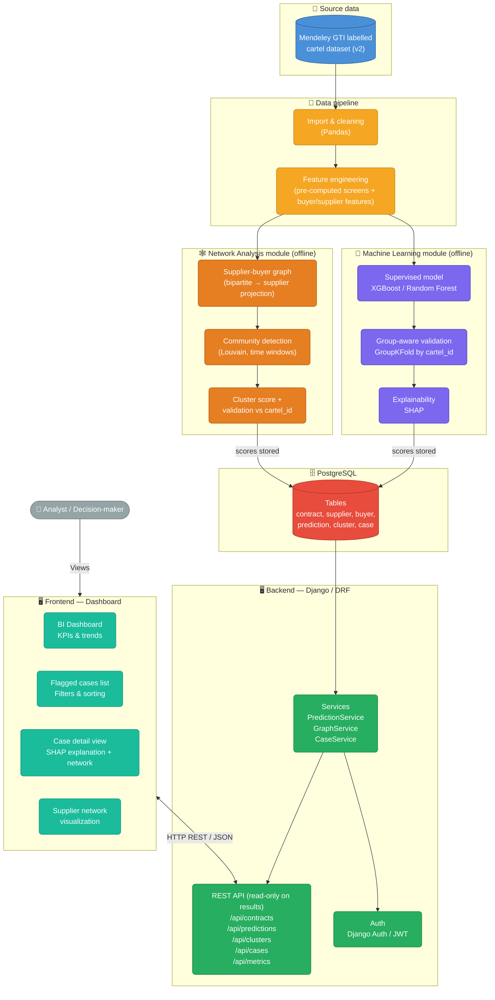
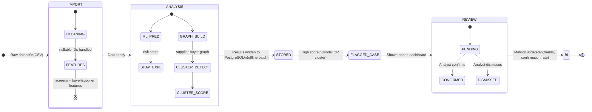

# Fraud & Collusion Detection in Public Procurement

Intelligent contract-analysis platform combining machine learning, network analysis, and a decision-support dashboard to flag contracts and supplier groups showing patterns linked to collusion (bid-rigging / cartels).

Academic project — Team of 4 students — Duration: ~1 semester.

---

## 1. Overall System Architecture



> **Key design rule:** model scoring and graph computation run **offline** (management commands) and write their results to PostgreSQL. The API only **reads** stored results — it never runs NetworkX or model training inside an HTTP request.

---

## 2. Dataset Reality Check (findings that shape the design)

First-pass EDA on `GTI_labelled_cartel_data_NOV2023.csv` (Mendeley Data, v2). These findings **replace earlier assumptions** and drive every module below.

| Finding | Evidence | Consequence |
|---|---|---|
| Small, well-sized file | 15,616 rows × 34 columns; 10,565 tenders; 1,001 suppliers; 2,984 buyers; 7 countries (anonymized as `country_1`…`country_7`); 2004–2021 | Everything runs on a laptop; no scale issues |
| **Winners only — losing bidders are not in the file** | Median tender has 1 row; ~78% of single-row tenders had more than one bid (`lot_bidscount > 1`) | **A co-bidding graph is impossible.** The network module uses supplier–buyer relationships instead (Section 5.3). No bid-gap or win/loss-ratio features |
| **Every row belongs to a cartel case** | `cartel_id` is never missing; 73 distinct cases | The model separates *collusion-period* contracts from *other contracts of known cartel firms* — not cartel firms from honest firms. State this in the report |
| Label is not rare | `is_cartel` = 1 for 41.9% of rows | This is a curated sample, not real-world prevalence. No SMOTE needed. **PR-AUC baseline ≈ 0.42** (random model) |
| Suppliers are almost cartel-specific | 996 of 1,001 suppliers appear in exactly one `cartel_id` | `bidder_id` is a proxy for the label — **never use it as a feature**. Group split by `cartel_id` is mandatory |
| One dominant supplier | One `bidder_id` has 1,973 rows = all of case `country_5_11` (only ~5% positive) | Must be handled explicitly in the graph and in evaluation (Section 5.3) |
| Case sizes are very uneven | Largest case ≈ 18% of all rows | Group-split results will vary a lot by fold — report mean **and** spread |
| Missing identifiers | `lot_id` 94%, `persistent_id` 77%, `buyer_id` 19% missing | These fields are nullable; none can be a key. Rows with no `buyer_id` are unusable for the graph |
| **No contract amount** | Only `relative_value` (+ averages/lags) | No "amount at risk" KPI. Check the methodology paper for the exact definition of `relative_value` |

**Columns never used as model features:** `is_cartel` (target), `cartel_id`, `cartel_tender` (2,300 distinct integer values — identifier-like), `persistent_id`, `tender_id`, `lot_id`, `bidder_id`, `buyer_id` (raw IDs).

**Limits to state honestly in the report:**
1. The dataset contains only firms linked to known cartels, so results say little about how the system would behave on a full market.
2. `is_cartel` is understood to mark contracts awarded during the documented collusion period; labels are noisy by construction (confirm in the methodology paper).
3. The supplier–buyer network is a weaker signal than true co-bidding.

---

## 3. Module Breakdown (4 students)

| Module | Owner | Content |
|---|---|---|
| **Backend & Data** | Student 1 | Django models, migrations, data import/cleaning, API endpoints, authentication, OpenAPI schema |
| **Machine Learning** | Student 2 | Feature engineering, supervised model training, group-aware validation, SHAP integration, batch scoring command |
| **Network Analysis (graph)** | Student 3 | Supplier–buyer graph construction (NetworkX), community detection, time-window logic, cluster score, validation against `cartel_id`, batch graph command |
| **Frontend & BI** | Student 4 | Dashboard, flagged-case list, detail view (explanation + network), BI charts (model metrics, trends, breakdowns by country/year/sector) |

> Each person can go beyond their own scope once their module is stable — this split is a starting point, not a strict boundary.

---

## 4. Processing Pipeline — Detailed View



---

## 5. Module Details

### 5.1 Backend & Data (Django)

- **Apps:** `core` (models, users/roles), `ingestion` (import/cleaning), `cases` (flagged cases), `ml_pipeline` (training, scoring), `graph_analysis` (graph computation).
- **Models (proposal — lock within the first two weeks):**
  - `Supplier` (dataset `bidder_id`, unique), `Buyer` (dataset `buyer_id`, unique).
  - `Contract` = one dataset row: auto primary key (**no natural key exists**), `tender_id`, `lot_id` *(nullable)*, `persistent_id` *(nullable)*, `country`, `tender_year`, `buyer` *(nullable FK)*, `supplier` (FK), `cpv2`, `lot_bids_count`, `relative_value`, the numeric risk screens (suggestion: one `JSONField` called `screens` instead of ~20 columns), plus ground truth `is_cartel` and `cartel_id` (**evaluation only — never used as features, never shown in case views**).
  - `Prediction`, `Cluster`, `ClusterMember`, `ClusterEdge`, `FlaggedCase`.
  - There is **no `Bid` model**: losing bids do not exist in the data.
- **Import command:** `manage.py import_data --source data/raw/GTI_labelled_cartel_data_NOV2023.csv`.
- **`cases` app:** `FlaggedCase` links a contract or a cluster to a score, a status (`pending/confirmed/dismissed`), a comment, reviewer and timestamps.
- **API (DRF):** see **Section 6 — API Contract**. OpenAPI schema generated with `drf-spectacular`.
- **Key point:** the schema is the shared foundation for the other 3 modules. Change it after the lock only through a team decision.

### 5.2 Machine Learning

- **Task framing:** classify contracts as `is_cartel` = 1 (collusion-period) vs 0 (other contracts of known cartel firms).
- **Features:**
  - the dataset's pre-computed screens and their lagged versions (single-bidding rates, `relative_value` averages, `lot_bidscount` averages, consortium/subcontracting indicators, supplier/buyer yearly averages, Benford and MAD screens, `contract_count_bidder_yearly`) — first study how each relates to the label;
  - your own features that work with winners-only data, e.g. share of a buyer's yearly contracts won by the supplier, number of distinct buyers per supplier per year, buyer concentration (HHI of winners per buyer-year).
  - Never use label-derived or identifier columns (see Section 2). Watch for features that let the model memorize firms.
- **Model:** XGBoost or Random Forest; start with a simple baseline (logistic regression) to show what the complex model adds.
- **Class balance:** ~42% positives, so no SMOTE. `class_weight` / `scale_pos_weight` are optional. Choose the decision threshold on a validation set.
- **Metrics:** PR-AUC (compare against the ≈0.42 baseline), precision, recall, F1 — never accuracy alone.
- **Validation (critical):** contracts of the same cartel are strongly correlated, so a random split leaks information. Use **`GroupKFold` with `cartel_id` as the group**. Because case sizes are very uneven, report the **mean and spread across folds** and consider a "leave the largest case out" experiment. Document everything.
- **Explainability:** SHAP values per prediction, stored with the prediction and exposed as `feature`, `value`, `impact`.
- **Deliverables:** reproducible `ml_pipeline/train.py`, serialized model in `ml_pipeline/artifacts/`, batch command `manage.py score_contracts` writing predictions + SHAP values to the database, `ml_pipeline/evaluate.py`.

### 5.3 Network Analysis (graph)

**Why not co-bidding:** the file only records winners, so "who bid together" is unknown. The network is built from **who wins from whom**.

- **Graph construction:** start from the bipartite supplier ↔ buyer graph (edge = supplier won at least one contract from that buyer). Project it onto suppliers: two suppliers are linked if they won from the same buyer(s); **weight = number of shared buyers** (optionally per time window).
- **Pitfalls to handle:**
  - rows with missing `buyer_id` (19%) are excluded — report how many and whether it differs by country/case;
  - a buyer connected to many suppliers creates huge cliques: down-weight (e.g. 1 / (number of that buyer's suppliers − 1)) or cap very large buyers;
  - the dominant supplier (1,973 rows) will distort the network: run with and without it and report both.
- **Time windows (stretch goal):** use `tender_year` and rolling windows (e.g. 2 years) so old relationships don't dominate.
- **Community detection:** Louvain (`python-louvain` or `networkx.algorithms.community`).
- **Validation experiment (key deliverable):** compare detected communities with the real `cartel_id` groups using NMI, ARI and purity. Report the result honestly, even if low.
- **Cluster score:** combine cohesion (density), buyer concentration and the mean model risk of member contracts. Since every firm in the file is already a cartel member, treat the score as a **relative ranking** of clusters, not an absolute probability.
- **Offline computation:** `manage.py compute_graph` persists clusters, members, edges and scores. **Never compute in an API request.**
- **Export:** nodes/edges + scores via `/api/clusters/{id}/` for visualization (`vis.js` or `D3.js`).

### 5.4 Frontend & BI

- **Main dashboard:** KPIs (flagged cases, pending/confirmed/dismissed, confirmation rate) and breakdowns by country, year and sector (`cpv2`). **No monetary KPI** — the data has no amounts.
- **Case list:** filter by status, source (model/cluster), score, period.
- **Case detail view:** contract fields, score, SHAP bar chart, and the supplier network of the related cluster.
- **Analyst actions:** confirm/dismiss buttons calling the API.
- **Model page:** PR-AUC with the 0.42 baseline line, per-fold results, confusion matrix.
- **Graph page:** community-vs-cartel validation metrics.
- **Working before the backend is ready:** build against the JSON files in `docs/api_examples/` (Section 6), then switch to real endpoints.

---

## 6. API Contract

**The shared agreement between all four modules.** Commit it to the repo and change it only through a merge request approved by everyone.

### 6.1 Conventions

- Base path `/api/`. JSON. `snake_case`. Dates in ISO 8601 (`2021-06-30` or `2021-06-30T14:05:00Z`); `tender_year` and window bounds are plain integers.
- Authentication: JWT (`Authorization: Bearer <token>`).
- Lists are paginated: `?page=1&page_size=20` → `{ "count", "next", "previous", "results": [...] }`.
- Scores (`risk_score`, `suspicion_score`) are floats in `[0, 1]`.
- Enums: case `status` ∈ `pending | confirmed | dismissed`; case `source` ∈ `model | cluster`.
- Fields that can be missing in the dataset (`lot_id`, `persistent_id`, `buyer_id`) are **nullable** and returned as `null`.
- Ground-truth labels (`is_cartel`, `cartel_id`) are **not exposed** by case/contract endpoints; they are used only for evaluation metrics.
- Errors: `{ "detail": "human readable message", "code": "machine_code" }` with standard HTTP codes (400, 401, 403, 404).

### 6.2 Roles

| Role | Permissions |
|---|---|
| `analyst` | Read everything, update case status/comment |
| `admin` | Everything, including user management and data import |
| `viewer` | Read-only access to `/api/metrics/*` |

### 6.3 Endpoints

| Method | Endpoint | Description | Owner |
|---|---|---|---|
| POST | `/api/auth/token/` | Obtain JWT | Backend |
| POST | `/api/auth/token/refresh/` | Refresh JWT | Backend |
| GET | `/api/contracts/` | Paginated contract list | Backend |
| GET | `/api/contracts/{id}/` | Contract detail incl. prediction | Backend |
| GET | `/api/predictions/{contract_id}/` | Risk score + SHAP explanation | ML |
| GET | `/api/clusters/` | Paginated cluster list | Graph |
| GET | `/api/clusters/{id}/` | Cluster detail with nodes and edges | Graph |
| GET | `/api/cases/` | Flagged cases (contracts or clusters) | Backend |
| GET | `/api/cases/{id}/` | Case detail | Backend |
| PATCH | `/api/cases/{id}/` | Confirm / dismiss a case | Backend |
| GET | `/api/metrics/summary/` | Dashboard KPIs | Backend / BI |
| GET | `/api/metrics/trends/` | Cases over time | Backend / BI |
| GET | `/api/metrics/model/` | Model performance | ML |
| GET | `/api/metrics/graph/` | Community-vs-cartel validation | Graph |

### 6.4 Request & response shapes

All IDs and numbers below are **illustrative placeholders**.

**`GET /api/contracts/`** — query params: `country`, `year_from`, `year_to`, `buyer_id`, `supplier_id`, `min_risk`, `case_status`, `ordering` (e.g. `-risk_score`).

```json
{
  "count": 15616,
  "next": "/api/contracts/?page=2",
  "previous": null,
  "results": [
    {
      "id": 1021,
      "tender_id": "T-88123",
      "lot_id": null,
      "persistent_id": null,
      "country": "country_2",
      "tender_year": 2014,
      "buyer_id": "B-3321",
      "supplier_id": "S-1045",
      "cpv2": "45",
      "lot_bids_count": 4,
      "relative_value": 0.93,
      "risk_score": 0.87,
      "case_status": "pending"
    }
  ]
}
```

**`GET /api/predictions/{contract_id}/`**

```json
{
  "contract_id": 1021,
  "model_version": "xgb_v1_2025-11-01",
  "risk_score": 0.87,
  "predicted_label": 1,
  "threshold": 0.65,
  "top_features": [
    { "feature": "singleb_avg", "value": 0.72, "impact": 0.31 },
    { "feature": "relative_value_avg", "value": 0.64, "impact": 0.22 },
    { "feature": "benfords_buyer_yearly_avg", "value": 0.02, "impact": -0.05 }
  ],
  "created_at": "2025-11-01T10:12:00Z"
}
```
`impact` is the SHAP value: positive pushes toward "suspicious", negative away. Return the top 10 features sorted by absolute impact.

**`GET /api/clusters/{id}/`**

```json
{
  "id": 17,
  "year_from": 2018,
  "year_to": 2019,
  "size": 6,
  "density": 0.8,
  "n_contracts": 42,
  "n_buyers": 9,
  "mean_model_risk": 0.71,
  "suspicion_score": 0.79,
  "nodes": [
    { "id": "S-1045", "label": "S-1045", "contract_count": 31, "n_buyers": 5 }
  ],
  "edges": [
    { "source": "S-1045", "target": "S-2210", "weight": 3 }
  ]
}
```
`weight` = number of shared buyers. The list endpoint `/api/clusters/` returns the same object **without** `nodes` and `edges`.

**`GET /api/cases/`** — query params: `status`, `source`, `min_score`, `date_from`, `date_to`, `ordering`.

```json
{
  "count": 312,
  "next": "/api/cases/?page=2",
  "previous": null,
  "results": [
    {
      "id": 55,
      "source": "model",
      "contract_id": 1021,
      "cluster_id": null,
      "score": 0.87,
      "status": "pending",
      "comment": "",
      "reviewed_by": null,
      "reviewed_at": null,
      "created_at": "2025-11-01T10:15:00Z"
    }
  ]
}
```
For `source = "cluster"`, `cluster_id` is filled and `contract_id` is `null`.

**`PATCH /api/cases/{id}/`** — analyst action (role `analyst` or `admin`).

```json
{ "status": "confirmed", "comment": "Same 3 suppliers keep winning from the same 4 buyers." }
```
Response `200`: the updated case (with `reviewed_by` and `reviewed_at` filled). `400` if `status` is not `confirmed` or `dismissed`.

**`GET /api/metrics/summary/`**

```json
{
  "flagged_total": 312,
  "pending": 190,
  "confirmed": 80,
  "dismissed": 42,
  "confirmation_rate": 0.66,
  "by_country": [ { "country": "country_2", "flagged": 120 } ],
  "by_year": [ { "tender_year": 2014, "flagged": 31 } ]
}
```
`confirmation_rate = confirmed / (confirmed + dismissed)`. There is no monetary field because the dataset has no contract amount.

**`GET /api/metrics/trends/`** — query params: `granularity` (`month` | `year`), `date_from`, `date_to`.

```json
{
  "granularity": "month",
  "points": [
    { "period": "2025-09", "flagged": 41, "confirmed": 12, "dismissed": 5 }
  ]
}
```

**`GET /api/metrics/model/`**

```json
{
  "model_version": "xgb_v1_2025-11-01",
  "evaluated_on": "group_kfold_by_cartel_id",
  "n_folds": 5,
  "baseline_pr_auc": 0.42,
  "pr_auc_mean": 0.71,
  "pr_auc_std": 0.12,
  "precision_mean": 0.66,
  "recall_mean": 0.62,
  "f1_mean": 0.64,
  "confusion_matrix": { "tn": 7600, "fp": 1468, "fn": 2300, "tp": 4248 }
}
```
The confusion matrix is pooled out-of-fold. Only `baseline_pr_auc` is based on real data; the rest are placeholders.

**`GET /api/metrics/graph/`**

```json
{
  "window": "2018-2019",
  "n_clusters": 23,
  "nmi": 0.41,
  "ari": 0.28,
  "purity": 0.63,
  "dominant_supplier_excluded": true
}
```

### 6.5 Working with the contract

- Every module owner provides **example JSON files** for their endpoints in `docs/api_examples/` (one per endpoint). The frontend builds against them immediately.
- `openapi.yaml` is generated with `python manage.py spectacular --file openapi.yaml`; if it disagrees with this section, fix the code or open a merge request to change the contract — never silently drift.
- Prediction and cluster data is **written by batch commands**, not by the API. The API only reads it (except `PATCH /api/cases/{id}/`).

---

## 7. Technical Stack

| Layer | Technology |
|---|---|
| Backend / API | Django, Django REST Framework, SimpleJWT, drf-spectacular (OpenAPI) |
| Database | PostgreSQL |
| Machine Learning | scikit-learn, XGBoost, SHAP, Pandas |
| Network analysis | NetworkX, python-louvain |
| Frontend | Django Templates + HTMX/Alpine.js *(or a separate framework if the team prefers)*, Chart.js, vis.js/D3.js for the graph |
| Version control | Git / GitHub |

---

## 8. Prerequisites

- [Python 3.11+](https://www.python.org/)
- [PostgreSQL 15+](https://www.postgresql.org/)
- [Node.js 18+](https://nodejs.org/) *(only if a separate frontend is used)*
- Git

---

## 9. Installation & Getting Started

### 9.1 Clone the project

```bash
git clone <repo-url>
cd <project-name>
```

### 9.2 Create a virtual environment and install dependencies

```bash
python -m venv venv
source venv/bin/activate      # Windows: venv\Scripts\activate
pip install -r requirements.txt
```

### 9.3 Configure environment variables

```bash
cp .env.example .env          # Windows: copy .env.example .env
```

Edit `.env`:

```env
DJANGO_SECRET_KEY=change-me
DEBUG=True

DB_NAME=fraud_detection
DB_USER=app
DB_PASSWORD=your_password
DB_HOST=localhost
DB_PORT=5432

MODEL_PATH=ml_pipeline/artifacts/classifier.pkl
```

### 9.4 Set up your local PostgreSQL

Each teammate runs their own local database. As the `postgres` superuser:

```sql
CREATE DATABASE fraud_detection;
CREATE USER app WITH PASSWORD 'your_password';
GRANT ALL PRIVILEGES ON DATABASE fraud_detection TO app;
GRANT ALL ON SCHEMA public TO app;
ALTER SCHEMA public OWNER TO app;
```

(On PostgreSQL 15+ the last two lines avoid `permission denied for schema public` during `migrate`.)

```bash
python manage.py migrate
python manage.py createsuperuser
```

### 9.5 Import and prepare the data

Download the CSV from the shared drive into `data/raw/`, verify its SHA-256 hash against `data/README.md`, then:

```bash
python manage.py import_data --source data/raw/GTI_labelled_cartel_data_NOV2023.csv
```

### 9.6 Train the model

```bash
python ml_pipeline/train.py
```

### 9.7 Run the offline batch jobs

```bash
python manage.py score_contracts     # predictions + SHAP values → DB
python manage.py compute_graph       # clusters, edges, scores → DB
```

Re-run these whenever the model or graph logic changes.

### 9.8 Run the server

```bash
python manage.py runserver
```

| Service | URL |
|---|---|
| Django app | http://localhost:8000 |
| API docs (Swagger UI) | http://localhost:8000/api/docs/ |
| Django admin | http://localhost:8000/admin |

---

## 10. Dataset

- **The only dataset used:** *Public procurement cartels: A large-sample testing of screens using machine learning* — Mendeley Data.
  - Link: https://data.mendeley.com/datasets/f3y4nrn3s6
  - **Pinned: Version 2 — DOI `10.17632/f3y4nrn3s6.2` — published 12 August 2025.**
  - File used: `GTI_labelled_cartel_data_NOV2023.csv` (the `.RData` file is the same data in R format and is not used).
  - License: CC BY-NC 3.0 — non-commercial use with attribution; cite the dataset and the methodology paper in the report.
  - Methodology reference: https://www.govtransparency.eu/wp-content/uploads/2023/04/Fazekas-et-al_PP-cartel-detection_GTI-WP_2023.pdf
- **Not used:** raw OpenTender data (unlabeled), Operation Car Wash (no confirmed public download), Tunisian TUNEPS notices (unlabeled).

> **Everyone works on the exact same file.** Share it through the team drive and record its filename and SHA-256 in `data/README.md`. Raw data is never committed to git.

### 10.1 EDA questions — status

| # | Question | Answer |
|---|---|---|
| 1 | Are all bidders of each tender recorded? | **No — winners only.** Co-bidding graph not possible |
| 2 | Are losing bid prices available? | **No.** Bid-gap features not possible |
| 3 | Real class ratio? | 41.9% positive (curated sample) |
| 4 | Cartel case identifier for a group split? | **Yes** — `cartel_id`, 73 cases |
| 5 | Missing data, and does it differ by country? | `lot_id` 94%, `persistent_id` 77%, `buyer_id` 19%. **Still to check:** breakdown by country and by case |
| 6 | How do the pre-computed screens relate to the label? | **Still to do** — first task for the ML module |

Open checks: how to treat the dominant supplier; whether missing `buyer_id` is concentrated in specific cases. Copy the detailed outputs into `docs/eda_findings.md`.

---

## 11. Git Workflow

### Branch naming

```
<type>/<module>-<short-description>

feature/backend-contract-model
feature/ml-xgboost-training
feature/graph-community-detection
feature/frontend-case-dashboard
bugfix/ml-shap-serialization
```

Types: `feature` · `bugfix` · `chore` · `docs`

### Commit convention

```
<module>: <verb> <description>

backend: add Contract model and its migrations
ml: train XGBoost model with group k-fold validation
graph: implement community detection via Louvain
frontend: display flagged case detail with SHAP explanation
```

### Collaboration rules

- `main` must always stay functional — no direct pushes, go through a merge request.
- Small, frequent merges rather than one branch sitting unmerged for weeks.
- The database schema is locked within the first two weeks — any later change is discussed as a team first.
- The API contract (Section 6) changes only through a merge request approved by all four members.
- Sync twice a week (15 min): blockers and changes to shared interfaces.
- Integration checkpoints: first end-to-end run (ugly but working) around mid-semester, then re-integrate every 2–3 weeks. Someone owns "`main` still runs end-to-end" each week (rotate it).

---

## 12. Tests

```bash
# Backend
python manage.py test

# ML module (model evaluation)
python ml_pipeline/evaluate.py
```

---

## 13. Environment Variables

| Variable | Description | Required |
|---|---|---|
| `DJANGO_SECRET_KEY` | Django secret key | ✅ |
| `DEBUG` | Debug mode | ✅ |
| `DB_NAME` | PostgreSQL database name | ✅ |
| `DB_USER` | PostgreSQL user | ✅ |
| `DB_PASSWORD` | PostgreSQL password | ✅ |
| `DB_HOST` | PostgreSQL host | ✅ |
| `DB_PORT` | PostgreSQL port | ✅ |
| `MODEL_PATH` | Path to the serialized ML model | ✅ |

---

## 14. Useful Links

| Resource | URL |
|---|---|
| Git repository | `<to fill in>` |
| Task board | `<to fill in>` |
| Dataset (Mendeley Data, v2) | https://data.mendeley.com/datasets/f3y4nrn3s6 |
| Dataset methodology paper | https://www.govtransparency.eu/wp-content/uploads/2023/04/Fazekas-et-al_PP-cartel-detection_GTI-WP_2023.pdf |
| SHAP documentation | https://shap.readthedocs.io/ |
| NetworkX documentation | https://networkx.org/documentation/stable/ |
| Django REST Framework | https://www.django-rest-framework.org/ |
| drf-spectacular | https://drf-spectacular.readthedocs.io/ |

---

*Academic project — Team of 4 students — 1 semester.*
