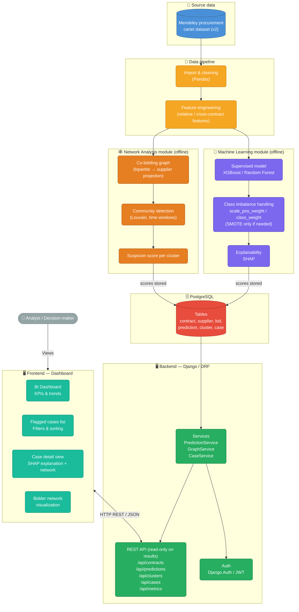
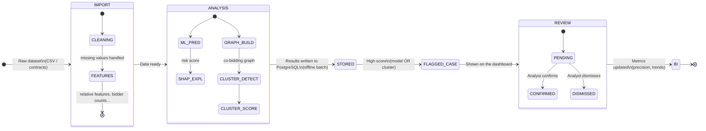

# Fraud & Collusion Detection in Public Procurement

Intelligent contract-analysis platform combining machine learning, network analysis, and a decision-support dashboard to detect collusion patterns between bidders (bid-rigging / cartels).

Academic project — Team of 4 students — Duration: ~1 semester.

---

## 1. Overall System Architecture



> **Key design rule:** model scoring and graph computation run **offline** (management commands / scripts) and write their results to PostgreSQL. The API only **reads** stored results — it never runs NetworkX or model training inside an HTTP request.

---

## 2. Module Breakdown (4 students)

| Module | Owner | Content |
|---|---|---|
| **Backend & Data** | Student 1 | Django models, migrations, data import/cleaning, API endpoints, authentication, OpenAPI schema |
| **Machine Learning** | Student 2 | Feature engineering, supervised model training, class imbalance handling, group-aware validation, SHAP integration, batch scoring command |
| **Network Analysis (graph)** | Student 3 | Co-bidding graph construction (NetworkX), community detection, time-window logic, suspicion score per cluster, batch graph command |
| **Frontend & BI** | Student 4 | Dashboard, flagged-case list, detail view (explanation + network), BI charts (precision/recall, trends, amounts) |

> Each person can go beyond their own scope once their module is stable — this split is a starting point, not a strict boundary.

---

## 3. Processing Pipeline — Detailed View



---

## 4. Module Details

### 4.1 Backend & Data (Django)

- **`core` app**: `Contract`, `Supplier`, `Bid` models, users and roles.
- **`ingestion` app**: scripts to load and clean the dataset (Django management command `manage.py import_data`).
- **`cases` app**: `FlaggedCase` model (links a contract or cluster to a risk score, a status `pending/confirmed/dismissed`, and an analyst comment).
- **API (DRF)**: exposes contracts, predictions, clusters, flagged cases and metrics, and receives analyst actions (confirm/dismiss). See **Section 5 — API Contract**.
- **OpenAPI schema**: generated with `drf-spectacular` (`python manage.py spectacular --file openapi.yaml`) so the frontend can build against it.
- **Key point:** the database schema (`Contract`/`Supplier`/`Bid` models) must be locked within the **first two weeks** — it's the shared foundation for the other 3 modules. If ML or Graph need aggregated relationships the schema doesn't support, everything stalls.

### 4.2 Machine Learning

- **Preprocessing**: encoding categorical variables, normalizing amounts, handling missing values.
- **Feature engineering**: simple per-contract features (amount, number of bidders) are rarely enough on their own. Prefer **relative / cross-contract features**, for example:
  - gap between winning bid and runner-up bid (if bid prices of losing bidders are available),
  - bidder win/loss ratios over rolling time windows,
  - how often two suppliers appear together relative to the total number of tenders in their market,
  - the dataset's own pre-computed cartel risk screens (use them as features and study how they relate to the label).
- **Model**: XGBoost or Random Forest, trained on labeled contracts (cartel-linked / not).
- **Class imbalance** (confirmed cartel contracts are rare): go in this order:
  1. cost-sensitive learning (`scale_pos_weight` in XGBoost, `class_weight` in scikit-learn),
  2. choose the decision threshold on a validation set,
  3. SMOTE only if the first two are clearly insufficient — it can create artificial points in high-dimensional feature spaces.
  Evaluate with **precision-recall AUC, precision, recall, F1** — never accuracy alone.
- **Validation (important):** contracts from the same cartel are strongly correlated, so a random train/test split leaks information and inflates scores. Split **by cartel case (group split)** if a case identifier exists, otherwise **by time period**. Document which one you used.
- **Explainability**: SHAP values computed per prediction, stored with the prediction and exposed via the API in a simple form (`feature`, `value`, `impact`).
- **Expected deliverables**: a reproducible training script (`train.py`), the serialized model (`.pkl` or XGBoost `.json`), and a batch command `manage.py score_contracts` that writes predictions + SHAP values to the database.

### 4.3 Network Analysis (graph)

- **Graph construction**: the raw data is bipartite (supplier ↔ tender). **Project it** into a supplier ↔ supplier graph: a node = a supplier, an edge = co-participation in the same tender, **weight = number of joint tenders**.
- **Community detection**: Louvain (via `python-louvain` or `networkx.algorithms.community`) to spot groups of suppliers that are abnormally connected.
- **Time windows (stretch goal):** cartels evolve, so avoid one static graph over many years. Build graphs on rolling windows (e.g. 2 years) so old relationships don't distort current suspicion scores.
- **Suspicion score per cluster**: based on cluster density, co-bidding frequency, and concentration of awarded contracts.
- **Offline computation:** graph algorithms are CPU-heavy. Run them in a management command (`manage.py compute_graph`) and persist clusters, members, edges and scores in PostgreSQL. **Never compute them inside an API request.**
- **Export**: nodes/edges + scores exposed via `/api/clusters/{id}/` so the frontend can visualize them (e.g. with `vis.js` or `D3.js`).
- **Dependency to verify after EDA:** this module needs to know **which suppliers bid on the same tender**. If the dataset only records winners, the co-bidding graph is not possible as designed. Fallback: link suppliers that repeatedly win from the same buyer, or that win in the same market/time window.

### 4.4 Frontend & BI

- **Main dashboard**: KPIs (number of flagged cases, confirmation rate, total amount at risk).
- **Case list**: filter by status, risk score, period.
- **Case detail view**: contract details, score, SHAP features (as a bar chart), and the network graph of the related cluster.
- **Analyst actions**: confirm/dismiss buttons that call the API and update the status.
- **BI / trends**: evolution of case count over time, model precision/recall metrics.
- **Working before the backend is ready:** build against the example JSON files in `docs/api_examples/` (see Section 5), then switch to the real endpoints.

---

## 5. API Contract

**This is the shared agreement between all four modules.** Agree on it in the first team meeting, commit it to the repo, and change it only through a merge request approved by everyone.

### 5.1 Conventions

- Base path: `/api/`. Format: JSON. Field names: `snake_case`. Dates: ISO 8601 (`2021-06-30` or `2021-06-30T14:05:00Z`).
- Authentication: JWT (`Authorization: Bearer <token>`).
- Lists are paginated: `?page=1&page_size=20` and return `{ "count", "next", "previous", "results": [...] }`.
- Scores (`risk_score`, `suspicion_score`) are floats between `0` and `1`.
- Enums: case `status` ∈ `pending | confirmed | dismissed`; case `source` ∈ `model | cluster`.
- Errors: `{ "detail": "human readable message", "code": "machine_code" }` with standard HTTP status codes (400, 401, 403, 404).
- Fields marked `*` depend on what the dataset actually contains — **confirm after EDA** and update this contract.

### 5.2 Roles

| Role | Permissions |
|---|---|
| `analyst` | Read everything, update case status/comment |
| `admin` | Everything, including user management and data import |
| `viewer` | Read-only access to `/api/metrics/*` |

### 5.3 Endpoints

| Method | Endpoint | Description | Owner |
|---|---|---|---|
| POST | `/api/auth/token/` | Obtain JWT (`username`, `password`) | Backend |
| POST | `/api/auth/token/refresh/` | Refresh JWT | Backend |
| GET | `/api/contracts/` | Paginated contract list | Backend |
| GET | `/api/contracts/{id}/` | Contract detail incl. prediction | Backend |
| GET | `/api/predictions/{contract_id}/` | Risk score + SHAP explanation | ML |
| GET | `/api/clusters/` | Paginated cluster list | Graph |
| GET | `/api/clusters/{id}/` | Cluster detail with nodes and edges | Graph |
| GET | `/api/cases/` | Flagged cases (contracts or clusters) | Backend |
| GET | `/api/cases/{id}/` | Case detail | Backend |
| PATCH | `/api/cases/{id}/` | Confirm / dismiss a case | Backend |
| GET | `/api/metrics/summary/` | Dashboard KPIs | Backend / BI |
| GET | `/api/metrics/trends/` | Cases over time | Backend / BI |
| GET | `/api/metrics/model/` | Model performance metrics | ML |

### 5.4 Request & response shapes

**`GET /api/contracts/`** — query params: `country*`, `year_from*`, `year_to*`, `buyer_id`, `supplier_id`, `min_risk`, `case_status`, `ordering` (e.g. `-risk_score`).

```json
{
  "count": 15234,
  "next": "/api/contracts/?page=2",
  "previous": null,
  "results": [
    {
      "id": 1021,
      "persistent_id": "ES-2014-000123",
      "tender_id": "T-88123",
      "lot_id": "L-1",
      "country": "ES",
      "year": 2014,
      "buyer_id": "B-3321",
      "supplier_id": "S-1045",
      "cpv_2digit": "45",
      "amount": 1250000.0,
      "n_bidders": 4,
      "risk_score": 0.87,
      "case_status": "pending"
    }
  ]
}
```

**`GET /api/predictions/{contract_id}/`**

```json
{
  "contract_id": 1021,
  "model_version": "xgb_v1_2025-11-01",
  "risk_score": 0.87,
  "predicted_label": 1,
  "threshold": 0.65,
  "top_features": [
    { "feature": "single_bidder_rate_buyer", "value": 0.72, "impact": 0.31 },
    { "feature": "winner_share_of_buyer_spend", "value": 0.64, "impact": 0.22 },
    { "feature": "bid_gap_to_runner_up", "value": 0.02, "impact": -0.05 }
  ],
  "created_at": "2025-11-01T10:12:00Z"
}
```
`impact` is the SHAP value: positive pushes toward "suspicious", negative away from it. Return the top 10 features sorted by absolute impact.

**`GET /api/clusters/{id}/`**

```json
{
  "id": 17,
  "window_start": "2018-01-01",
  "window_end": "2019-12-31",
  "size": 6,
  "density": 0.8,
  "n_contracts": 42,
  "total_amount": 9800000.0,
  "suspicion_score": 0.79,
  "nodes": [
    { "id": "S-1045", "label": "S-1045", "bid_count": 31, "win_count": 12 }
  ],
  "edges": [
    { "source": "S-1045", "target": "S-2210", "weight": 14 }
  ]
}
```
The list endpoint `/api/clusters/` returns the same object **without** `nodes` and `edges`.

**`GET /api/cases/`** — query params: `status`, `source`, `min_score`, `date_from`, `date_to`, `ordering`.

```json
{
  "count": 312,
  "next": "/api/cases/?page=2",
  "previous": null,
  "results": [
    {
      "id": 55,
      "source": "model",
      "contract_id": 1021,
      "cluster_id": null,
      "score": 0.87,
      "status": "pending",
      "comment": "",
      "reviewed_by": null,
      "reviewed_at": null,
      "created_at": "2025-11-01T10:15:00Z"
    }
  ]
}
```
For `source = "cluster"`, `cluster_id` is filled and `contract_id` is `null`.

**`PATCH /api/cases/{id}/`** — analyst action (role `analyst` or `admin`).

Request:
```json
{ "status": "confirmed", "comment": "Same 3 suppliers rotate wins across 6 tenders." }
```
Response `200`: the updated case object (same shape as above, with `reviewed_by` and `reviewed_at` filled). Returns `400` if `status` is not `confirmed` or `dismissed`.

**`GET /api/metrics/summary/`**

```json
{
  "flagged_total": 312,
  "pending": 190,
  "confirmed": 80,
  "dismissed": 42,
  "confirmation_rate": 0.66,
  "amount_at_risk": 48200000.0
}
```
`confirmation_rate = confirmed / (confirmed + dismissed)`.

**`GET /api/metrics/trends/`** — query params: `granularity` (`month` | `year`), `date_from`, `date_to`.

```json
{
  "granularity": "month",
  "points": [
    { "period": "2025-09", "flagged": 41, "confirmed": 12, "dismissed": 5 }
  ]
}
```

**`GET /api/metrics/model/`**

```json
{
  "model_version": "xgb_v1_2025-11-01",
  "evaluated_on": "group_split_test_set",
  "pr_auc": 0.41,
  "precision": 0.52,
  "recall": 0.47,
  "f1": 0.49,
  "confusion_matrix": { "tn": 9200, "fp": 310, "fn": 280, "tp": 250 }
}
```
(All numbers above are illustrative placeholders.)

### 5.5 Working with the contract

- Every module owner provides **example JSON files** for their endpoints in `docs/api_examples/` (one file per endpoint, shaped exactly as above). The frontend builds against them immediately.
- `openapi.yaml` is generated from the Django code with `drf-spectacular`; if the generated schema and this section disagree, fix the code or open a merge request to change the contract — never silently drift.
- Prediction and cluster data is **written by batch commands**, not by the API. The API only reads it (except `PATCH /api/cases/{id}/`).

---

## 6. Technical Stack

| Layer | Technology |
|---|---|
| Backend / API | Django, Django REST Framework, drf-spectacular (OpenAPI) |
| Database | PostgreSQL |
| Machine Learning | scikit-learn, XGBoost, SHAP, Pandas (imbalanced-learn only if SMOTE ends up being needed) |
| Network analysis | NetworkX, python-louvain |
| Frontend | Django Templates + HTMX/Alpine.js *(or a separate framework if the team prefers)*, Chart.js, vis.js/D3.js for the graph |
| Version control | Git / GitLab or GitHub |

---

## 7. Prerequisites

- [Python 3.11+](https://www.python.org/)
- [PostgreSQL 15+](https://www.postgresql.org/)
- [Node.js 18+](https://nodejs.org/) *(only if a separate frontend is used)*
- Git

---

## 8. Installation & Getting Started

### 8.1 Clone the project

```bash
git clone <repo-url>
cd <project-name>
```

### 8.2 Create a virtual environment and install dependencies

```bash
python -m venv venv
source venv/bin/activate      # Windows: venv\Scripts\activate
pip install -r requirements.txt
```

### 8.3 Configure environment variables

```bash
cp .env.example .env
```

Edit `.env`:

```env
# Django
DJANGO_SECRET_KEY=change-me
DEBUG=True

# Database
DB_NAME=fraud_detection
DB_USER=app
DB_PASSWORD=your_password
DB_HOST=localhost
DB_PORT=5432

# Machine Learning
MODEL_PATH=ml/models/classifier.pkl
```

### 8.4 Set up the database

```bash
python manage.py migrate
python manage.py createsuperuser
```

### 8.5 Import and prepare the data

Download the dataset (see Section 9) into `data/raw/`, then:

```bash
python manage.py import_data --source data/raw/<dataset_file>.csv
```

### 8.6 Train the model (ML module)

```bash
cd ml
python train.py
```

### 8.7 Run the offline batch jobs

```bash
python manage.py score_contracts     # writes predictions + SHAP values to the DB
python manage.py compute_graph       # writes clusters, edges and scores to the DB
```

Re-run these whenever the model or the graph logic changes.

### 8.8 Run the server

```bash
python manage.py runserver
```

| Service | URL |
|---|---|
| Django app | http://localhost:8000 |
| API docs (Swagger UI, via drf-spectacular) | http://localhost:8000/api/docs |
| Django admin | http://localhost:8000/admin |

---

## 9. Dataset

- **Primary (the only dataset used for training):** *Public procurement cartels: A large-sample testing of screens using machine learning* — Mendeley Data.
  - Link: https://data.mendeley.com/datasets/f3y4nrn3s6
  - **Pinned version: Version 2 — DOI `10.17632/f3y4nrn3s6.2` — published 12 August 2025.**
  - Content: contract-level procurement data from seven European countries (Bulgaria, France, Hungary, Latvia, Portugal, Spain, Sweden), 2004–2021, linked to 73 confirmed cartel cases, with pre-computed cartel risk screens.
  - Methodology reference: https://www.govtransparency.eu/wp-content/uploads/2023/04/Fazekas-et-al_PP-cartel-detection_GTI-WP_2023.pdf
- **Not used for now:** raw OpenTender data (unlabeled), Operation Car Wash (no confirmed public download), Tunisian TUNEPS notices (unlabeled).

> **Everyone works on the exact same file.** Share the raw file through a shared drive and record its filename and checksum (e.g. SHA-256) in `data/README.md`. Raw data is never committed to git (see `.gitignore`) — only import scripts and a small sample.

### 9.1 Questions to answer in the EDA (before locking the schema)

These decide what the schema, features and graph module can actually do:

1. Are **all bidders** of each tender recorded, or only the winner? (Decides whether the co-bidding graph is possible.)
2. Are **losing bid prices** available? (Decides whether bid-gap features are possible.)
3. What is the real **class ratio** (cartel-linked contracts vs total)?
4. Is there a **cartel case identifier** usable for a group split? If not, use a time-based split.
5. How much is missing, and does it differ by country?
6. How do the pre-computed risk screens relate to the label?

Write the answers in `docs/eda_findings.md` and update Sections 4 and 5 accordingly.

---

## 10. Git Workflow

### Branch naming convention

```
<type>/<module>-<short-description>

feature/backend-contract-model
feature/ml-xgboost-training
feature/graph-community-detection
feature/frontend-case-dashboard
bugfix/ml-shap-serialization
```

Types: `feature` · `bugfix` · `chore` · `docs`

### Commit convention

```
<module>: <verb> <description>

backend: add Contract model and its migrations
ml: train XGBoost model with class weights
graph: implement community detection via Louvain
frontend: display flagged case detail with SHAP explanation
```

### Collaboration rules

- `main` must always stay functional — no direct pushes, go through a merge request.
- Small, frequent merges rather than one branch sitting unmerged for weeks.
- The database schema (`core` models) is locked within the first two weeks — any later change is discussed as a team before being applied.
- The API contract (Section 5) changes only through a merge request approved by all four members.
- Recommended sync point: twice a week (15 min), to flag blockers and any changes to shared interfaces (API contract, data format).
- Integration checkpoints: first end-to-end run (ugly but working) around mid-semester, then re-integrate every 2–3 weeks. Someone owns "`main` still runs end-to-end" each week (rotate it).

---

## 11. Tests

```bash
# Backend
python manage.py test

# ML module (model evaluation scripts)
cd ml && python evaluate.py
```

---

## 12. Environment Variables

| Variable | Description | Required |
|---|---|---|
| `DJANGO_SECRET_KEY` | Django secret key | ✅ |
| `DEBUG` | Debug mode | ✅ |
| `DB_NAME` | PostgreSQL database name | ✅ |
| `DB_USER` | PostgreSQL user | ✅ |
| `DB_PASSWORD` | PostgreSQL password | ✅ |
| `DB_HOST` | PostgreSQL host | ✅ |
| `DB_PORT` | PostgreSQL port | ✅ |
| `MODEL_PATH` | Path to the serialized ML model | ✅ |

---

## 13. Useful Links

| Resource | URL |
|---|---|
| Git repository | `<to fill in>` |
| Task board (Trello/Jira/GitHub Projects) | `<to fill in>` |
| Dataset (Mendeley Data, v2) | https://data.mendeley.com/datasets/f3y4nrn3s6 |
| Dataset methodology paper | https://www.govtransparency.eu/wp-content/uploads/2023/04/Fazekas-et-al_PP-cartel-detection_GTI-WP_2023.pdf |
| SHAP documentation | https://shap.readthedocs.io/ |
| NetworkX documentation | https://networkx.org/documentation/stable/ |
| Django REST Framework documentation | https://www.django-rest-framework.org/ |
| drf-spectacular documentation | https://drf-spectacular.readthedocs.io/ |

---

*Academic project — Team of 4 students — 1 semester.*
